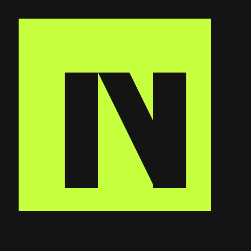
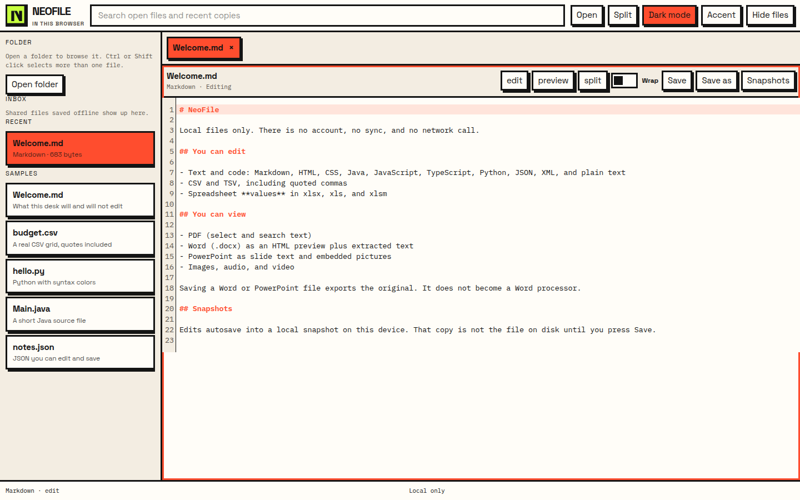
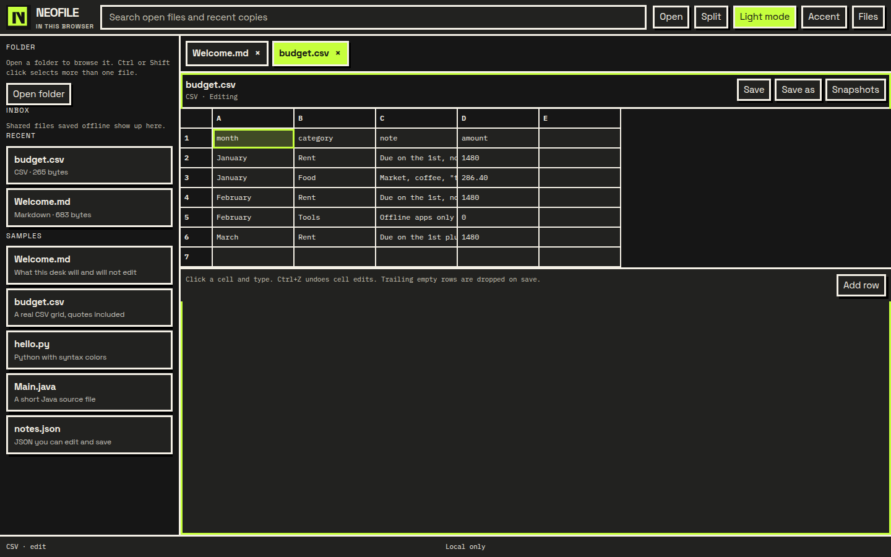
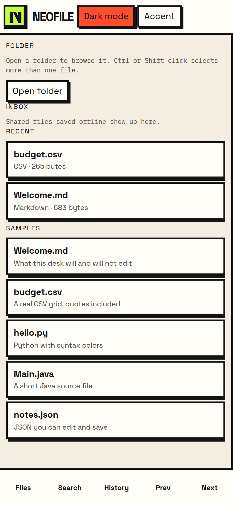
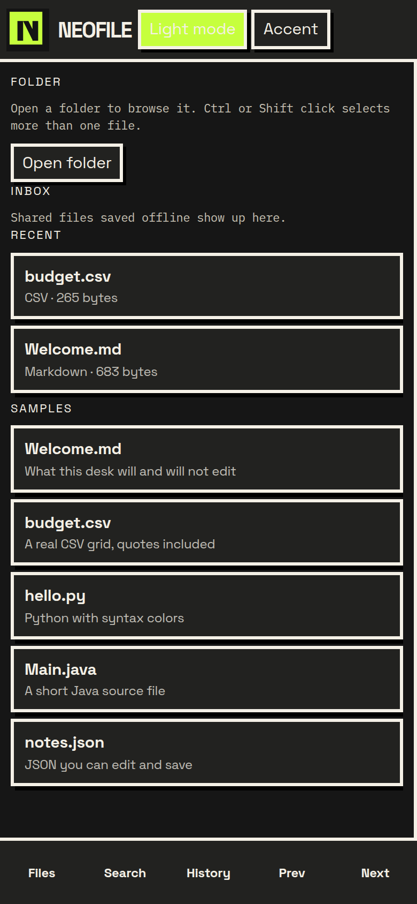

<p align="center">
  
</p>

<h1 align="center">NeoFile</h1>

<p align="center">
  An offline file desk for Android, Windows, macOS, iOS, and Linux.<br>
  Text and CSV are editable. Word, PowerPoint, PDF, and media are honest previews.
</p>

<p align="center">
  <a href="https://github.com/Himanshu-5680/NeoFile/actions/workflows/ci.yml"></a>
  <a href="https://github.com/Himanshu-5680/NeoFile/releases/latest"></a>
  <a href="LICENSE"></a>
</p>

<p align="center">
  
  
</p>

<p align="center">
  
  
</p>

## Download

Release [v1.0.0](https://github.com/Himanshu-5680/NeoFile/releases/tag/v1.0.0). These builds are not signed with an Apple or Microsoft certificate. See the install notes before the first launch.

| Platform | File | Install |
| --- | --- | --- |
| Android | [NeoFile-1.0.0.apk](https://github.com/Himanshu-5680/NeoFile/releases/download/v1.0.0/NeoFile-1.0.0.apk) | Copy the APK to the phone and open it. Allow install from your files app if Android asks. |
| Windows | [NeoFile_1.0.0_x64-setup.exe](https://github.com/Himanshu-5680/NeoFile/releases/download/v1.0.0/NeoFile_1.0.0_x64-setup.exe) · [MSI](https://github.com/Himanshu-5680/NeoFile/releases/download/v1.0.0/NeoFile_1.0.0_x64.msi) | SmartScreen may say "Windows protected your PC". Choose **More info**, then **Run anyway**. |
| macOS Apple silicon | [NeoFile_1.0.0_aarch64.dmg](https://github.com/Himanshu-5680/NeoFile/releases/download/v1.0.0/NeoFile_1.0.0_aarch64.dmg) | Gatekeeper blocks unsigned apps. Right-click the app, choose **Open**, then **Open** again. |
| macOS Intel | [NeoFile_1.0.0_x64.dmg](https://github.com/Himanshu-5680/NeoFile/releases/download/v1.0.0/NeoFile_1.0.0_x64.dmg) | Same Gatekeeper step as Apple silicon. |
| Linux | [NeoFile_1.0.0_amd64.deb](https://github.com/Himanshu-5680/NeoFile/releases/download/v1.0.0/NeoFile_1.0.0_amd64.deb) · [AppImage](https://github.com/Himanshu-5680/NeoFile/releases/download/v1.0.0/NeoFile_1.0.0_amd64.AppImage) | `sudo apt install ./NeoFile_1.0.0_amd64.deb`, or `chmod +x` the AppImage and run it. |
| iOS | [NeoFile-1.0.0-unsigned.ipa](https://github.com/Himanshu-5680/NeoFile/releases/download/v1.0.0/NeoFile-1.0.0-unsigned.ipa) | Unsigned. Sideload with AltStore or Sideloadly. Steps below. |

The logo is [assets/logo.svg](assets/logo.svg). A 1024 px PNG is attached to the release as `logo-1024.png`.

## Install notes

### Android

The APK requests no `INTERNET` permission. The release file in CI is signed with the test key in `apps/web/signing` so it can be installed. That key is public. Do not use it for a Play Store app.

### Windows

Closing the window hides NeoFile in the system tray. Quit from the tray menu. SmartScreen appears because the installer is not Authenticode-signed.

### macOS

Open the DMG and drag NeoFile to Applications. If Gatekeeper still refuses after the right-click Open, run `xattr -cr /Applications/NeoFile.app` and try the right-click again. The app is not notarized.

### Linux

The `.deb` depends on WebKitGTK 4.1, which Ubuntu 24.04 provides. The AppImage is the same app in one file. Video playback in the AppImage needs the system GStreamer plugins (`gstreamer1.0-plugins-good` on Debian and Ubuntu).

### iOS sideload

The IPA from CI is **unsigned**. iOS will not install it from Files. AltStore and Sideloadly re-sign it with your Apple ID.

Sideloadly:

1. Install [Sideloadly](https://sideloadly.io/) on a computer.
2. Connect the iPhone and trust the computer.
3. Drop `NeoFile-1.0.0-unsigned.ipa` into Sideloadly and sign in with an Apple ID. A free Apple ID works.
4. On the phone, open Settings → General → VPN & Device Management and trust the developer certificate.
5. A free account’s signature lasts about 7 days. Refresh it from Sideloadly when the app stops opening.

AltStore:

1. Install [AltServer](https://altstore.io/) on a computer and AltStore on the phone.
2. In AltStore, use **My Apps → +** and pick the IPA. Sign in with an Apple ID.
3. Trust the certificate under VPN & Device Management. Refresh AltStore at least every 7 days on a free account.

## What it does

- Edit text and code, with syntax colors for JavaScript, TypeScript, JSX, Python, HTML, CSS, JSON, XML, Java, and Markdown.
- Edit CSV and TSV, including quoted commas.
- Edit spreadsheet **values** in xlsx, xlsm, and xls.
- View PDF with text selection and search.
- Preview Word as HTML plus extracted text. Export HTML is not a Word file.
- Preview PowerPoint as slide text and embedded pictures. Layout is not rendered.
- Play images, audio, and video. Save exports the original. There is no media editor.
- Tabs, split view, search, drag-and-drop, a folder tree with multi-select, and local snapshots.
- Light mode uses a coral accent. Dark mode is one tap and uses neon green. You can set a custom accent.
- Android: swipe between files in a folder, and an offline inbox for files received from the share sheet.

## Known limits

SheetJS community edition does not recalculate formulas. Saving a workbook writes cell values and drops charts, pivot tables, macros, images, comments, and most formatting.

Mammoth’s Word preview can miss text boxes, comments, tracked changes, and complex layout. PowerPoint does not show slide positions, animation, charts, or SmartArt.

Sheets larger than 20,000 rows or 100 columns open as a download-only file. Auto snapshots skip payloads over 2 MB.

## Privacy

NeoFile does not have an account, sync, or analytics. Fonts are bundled. The production page’s Content-Security-Policy does not allow ordinary web requests. Recent files and snapshots stay in on-device IndexedDB. Erase them from the Privacy panel. That does not delete the original files in your folders.

## Build from source

Requirements: Node.js 22.

```bash
npm install
npm test
npm run dev
```

| Target | Command | Machine |
| --- | --- | --- |
| Browser bundle | `npm run build` | Any |
| Android APK | `bash scripts/build-android.sh` | Linux, macOS, or Windows with JDK 21 and Android SDK 35. `ANDROID_HOME` must be set. |
| Linux deb and AppImage | `npm run desktop:build` | Linux with the Tauri WebKitGTK packages |
| Windows exe and msi | `powershell -File scripts/build-windows.ps1` | Windows with Rust and the Visual Studio C++ tools |
| macOS dmg | `cd apps/desktop && npx tauri build --target aarch64-apple-darwin --bundles dmg` | macOS. Use `x86_64-apple-darwin` for Intel. |
| iOS unsigned IPA | `bash scripts/build-ios-unsigned.sh` | macOS with Xcode |

Pushing a `v*` tag runs `.github/workflows/release.yml`, which builds all of the above and attaches them to a GitHub Release.

The release workflow signs the APK from GitHub Actions secrets, not from a keystore in the repo. Set `ANDROID_KEYSTORE_BASE64`, `ANDROID_KEYSTORE_PASSWORD`, `ANDROID_KEY_PASSWORD`, and `ANDROID_KEY_ALIAS`.

## Tech stack

First-party source is about 0.3 MB (`node scripts/size-budget.mjs`), under a 10 MB cap. PDF.js, SheetJS, and CodeMirror are npm dependencies loaded in separate chunks, not copied into the git tree.

One React, TypeScript, and Vite UI. CodeMirror 6 edits text. A small grid edits CSV. SheetJS reads and writes spreadsheet values. PDF.js draws PDFs. Mammoth previews docx. JSZip plus a small XML reader previews pptx. Tauri 2 is the desktop shell. Capacitor 7 is the Android and iOS shell. Vitest covers the local core.

## Folder structure

```
assets/                 master logo SVG and PNG
apps/web                shared UI
apps/web/android        Android project
apps/web/ios            iOS project
apps/desktop            Tauri shell
packages/core           parsing, snapshots, search, theme, tests
docs/screenshots        captures of the running app
scripts                 icon render, APK, unsigned IPA, Windows installer
.github/workflows       CI and the multi-platform release
```

## Contributing

See [CONTRIBUTING.md](CONTRIBUTING.md). Changes that need a network service do not fit this app.

## License

[MIT](LICENSE). PDF.js and SheetJS community are Apache-2.0. Mammoth is BSD. CodeMirror and JSZip are MIT. The bundled fonts are SIL Open Font License.
